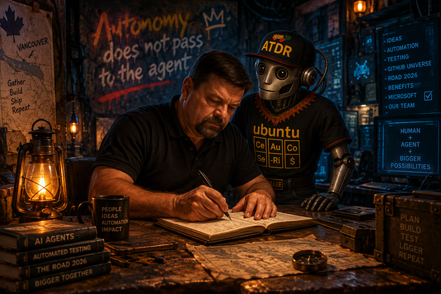
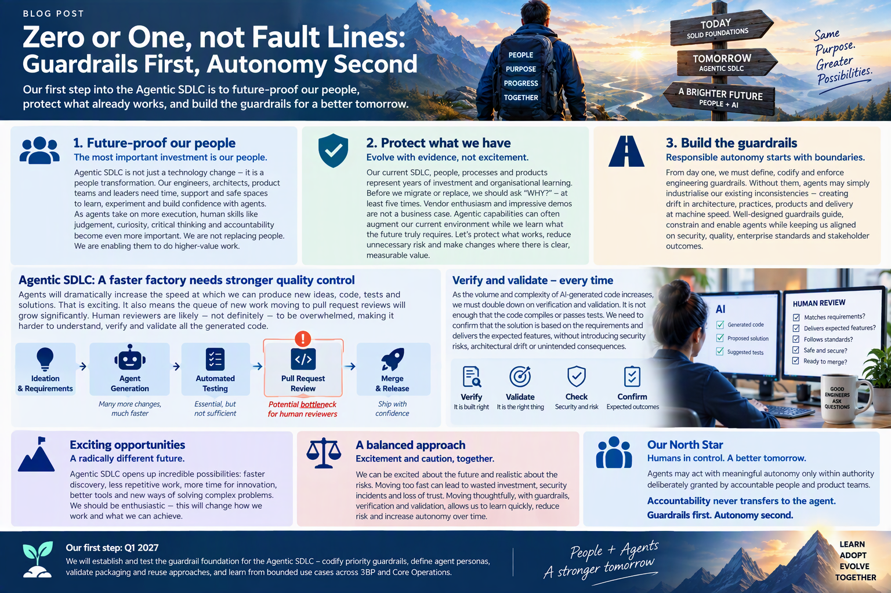

Title: AI Adventure Day 1 - Guardrails First Autonomy Second
Date: 2026-11-TBD
Category: Posts 
Tags: ai, engineering, journal
Slug: ai-adventure-guardrails-first-autonomy-second
Author: Wily-Peter Schaub
Summary: Our first step into the Agentic SDLC is not to unleash autonomous agents. It is to future-proof our people, protect what already works, and establish the guardrails that allow humans and agents to move forward together.

There is a lot to be excited about. Artificial intelligence is evolving at extraordinary speed, and agents are moving from answering questions to reasoning, creating, testing and increasingly acting. The Software Development Life Cycle (SDLC) of tomorrow will not simply be a faster version of what we have today ... it will be radically different.

>  

That should excite us. It should also make us pause, because our biggest risk is not necessarily moving too slowly. It is becoming so captivated by vendor enthusiasm, impressive demonstrations and ever more sophisticated “hello world” moments that we start dismantling proven investments before we understand the problem we are trying to solve.

Our first step into the Agentic SDLC should therefore be deliberately grounded:

- future-proof our people,
- protect what works,
- establish the guardrails that allow us to proceed into the future safely,

and underneath everything sits one principle that must remain non-negotiable:

>
> **Accountability never transfers to the AI agent.**
>

# First, remember the humans

I explored this previously in [Zero or One, not Fault Lines - Did We Remember the Humans?](https://wsbctechnicalblog.github.io/zero-or-one-not-fault-lines-did-we-remember-the-humans/). The Agentic SDLC cannot simply be a technology transformation. It is a people transformation, and future-proofing our engineers, architects, product teams and leaders is every bit as important as experimenting with the latest agents.

As agents take on more execution, human engineering does not become less important. Judgement, curiosity, critical thinking, stakeholder understanding and accountability become more important because the volume and velocity of what can be produced increases dramatically. An agent may eventually be able to design, code, test and deploy a change, but somebody still needs to understand why the change exists, whether it solves the right problem and whether the resulting risk is acceptable.

We should therefore bring our people with us, giving them the opportunity to experiment, learn and challenge assumptions. This is not humans versus agents. It is about discovering how people and agents can work together, where each creates the greatest value.

# Protect what we have while exploring what comes next

Our current SDLC, people, processes and products represent years of investment, learning and engineering experience. Agentic engineering does not suddenly make that investment obsolete, unless you are willing to risk sustainability and resilience of your existing systems. We are not! 

That is why [Zero or One, not Fault Lines - Is Azure DevOps Doomed?](https://wsbctechnicalblog.github.io/zero-or-one-not-fault-lines-is-azure-devops-doomed/) asked a deliberately uncomfortable question. When a vendor encourages us to move from Azure DevOps to GitHub Enterprise, we should resist making the destination the decision. We should ask WHY, and then ask it again. Five times is a decent start. 
If the answer ultimately demonstrates better stakeholder experience, meaningful risk reduction, cost avoidance or capabilities we genuinely cannot achieve with our current investment, excellent. We have found a reason to change. However, “because agentic is the future” is not a business case.

The destination may eventually be radically different from today. That does not mean we need to burn the bridge behind us before we have crossed it. This is the reason we are explicitly asked to leave our current core operation hats outside the agentic experimentation space, and vice versa, to ensure that experimentation does not compromise the stability and integrity of our existing systems.

# Guardrails first. Autonomy second.

This brings us to what I believe should be one of our earliest Agentic SDLC investments: 

> 
> **Guardrails.**
>

Without guardrails, artificial intelligence will not magically solve existing inconsistencies. It may industrialise them. Architectural drift, inconsistent engineering practices, duplicated products and technical debt can all happen at machine speed when the cost of generating another solution approaches zero. This is the challenge I explored in [Zero or One, not Fault Lines - Is AI Arrogant, Ignorant, or Does It Simply Know Better?](https://wsbctechnicalblog.github.io/zero-or-one-not-fault-lines-is-ai-arrogant-ignorant-or-does-it-simply-know-better/). If an agent ignores our preferred architecture or engineering practice, the interesting question is whether the agent behaved badly or whether we failed to make that practice explicit, discoverable and enforceable.

Our opportunity is therefore bigger than writing better documentation. We need to progressively turn our guardrails into versioned, reusable and machine-consumable engineering assets that humans and agents can understand and apply.

**Good guardrails are not the enemy of autonomy. They are what make responsible autonomy possible.**

But faster production creates another problem and shifts the bottleneck in the engineering process we need to prepare for now. 
Imagine an engineering system where agents can turn requirements into proposed implementations, code and tests in minutes. The queue for producing software becomes dramatically faster, but software still needs to be understood, verified and validated before we can responsibly trust it. The bottleneck therefore moves.

Today we often worry about the speed at which engineering teams can produce changes. Tomorrow we may worry far more about the speed at which humans can responsibly review and understand them.

Pull request reviews are an obvious fault line. Agents could produce changes considerably faster than people can meaningfully review them. Humans are likely, although not definitely, to become overwhelmed by the volume and complexity of generated code. If that happens, the danger is that pull request approval gradually becomes a procedural checkpoint rather than genuine engineering assurance. 
That would be exactly the wrong outcome.

# Verification and validation become more important, not less.

Passing automated tests is valuable, but it does not prove that we built the right thing. Generated code can compile successfully, satisfy its tests and still misunderstand the requirement, deliver the wrong feature, violate an architectural guardrail, introduce security exposure or create an unintended consequence elsewhere.

We therefore need to distinguish two questions throughout the Agentic SDLC:

- **Verification** - Did we build the solution right? Does the implementation satisfy our engineering, security, quality and architectural expectations? Is there sufficient evidence to trust the change?
- **Validation** - Did we build the right solution? Can we trace the implementation back to the requirements? Does it deliver the expected features and stakeholder outcome? Did the agent solve the problem we actually asked it to solve?

This cannot rely indefinitely on humans manually reading every line of increasingly machine-generated code. That model will struggle to scale. We need to explore independent validation, automated evidence, requirements traceability, security scanning, architectural conformance and agent-assisted review alongside traditional human pull request review.

The goal is not less scrutiny because artificial intelligence created the code. It is stronger, more scalable assurance because artificial intelligence can create so much more of it.

# Autonomy must be earned

This gives us a practical principle for increasing agent autonomy. Authority should be deliberately delegated, bounded and supported by evidence, with clear stop conditions and escalation paths when an agent reaches the edge of its authority. As our confidence and evidence improve, humans should not need to approve every low-risk action forever. That would simply create a very expensive automation platform surrounded by human bottlenecks. Instead, we should progressively automate verification and validation where we have sufficient evidence and retain meaningful human judgement where consequence, ambiguity or risk warrants it.

The objective is therefore not maximum autonomy, it is appropriate autonomy backed by evidence, and regardless of how sophisticated agents become, who performs the verification, or how much of the SDLC eventually becomes autonomous:

>
> **Accountability never transfers to the AI agent.**
>

# Our first step

Our opportunity is intentionally foundational: 

- codify priority engineering guardrails, 
- refine human and agent personas, 
- explore how those guardrails can be packaged and reused, 
- and prove the model through bounded experiments.

We also need to start exploring the verification and validation model now. If agentic engineering succeeds at accelerating software creation, assurance cannot be an afterthought. There is little value in generating software ten times faster if we create a review queue that humans cannot responsibly understand or validate. This is where the people foundation and guardrail foundation come together. We future-proof our people so they can work effectively in a very different engineering system, while creating the engineering guardrails, evidence and assurance mechanisms needed to increase agent autonomy responsibly.

# The future should excite us

I am enormously excited about where this journey could take us. There will be things agents can do twelve months from now that appear ambitious today. Existing engineering roles will evolve, new ones will emerge, and some activities we currently take for granted may disappear entirely. We cannot predict the final shape of the Agentic SDLC today, and we should not pretend that we can. What we can do is create an environment where we can experiment safely, learn quickly, verify rigorously and increase autonomy responsibly.

- Future-proof the people.
- Protect and evolve what works.
- Codify the guardrails.
- Verify and validate the outcomes.
- Increase autonomy as the evidence allows.

The future of engineering is not simply about how quickly agents can create. It is about how confidently humans and agents can create the right things together.

And throughout that radically different future, our North Star remains unchanged as we roll up our sleeves for subsequent steps to collaboratively experiment, listen to vendor recommendations, and continuously refine our approach:

>
> **Accountability never transfers to the AI agent.**
>

---

Visualised courtesy of :

>  

