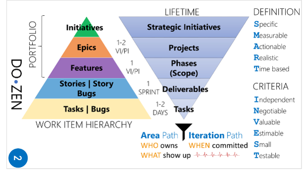
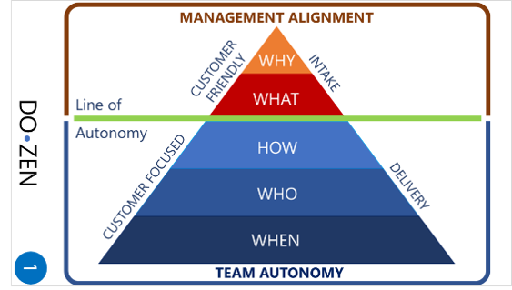
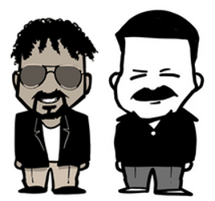

Title: Perhaps the Future of Engineering Is More Human, Not Less
Date: 2026-10-30
Category: Posts 
Tags: ai, agile, engineering
Slug: perhaps-the-future-of-engineering-is-more-human-not-less
Author: Willy-Peter Schaub
Summary: Perhaps our greatest artificial intelligence risk is not losing control of the machines, but losing sight of why we are building.

We are entering an era where our ability **to produce solutions is increasing far faster than our ability to determine whether those solutions are worth producing**.

## That changes everything.

An army of artificial intelligence agents can analyse, generate, test, document, and iterate while we sleep. In less than a night, we can increasingly generate more source code than our human teams could realistically peer review the next morning.

## Our constraint is shifting.

**Generating the solution is becoming easier. Understanding the problem, recognising value, applying judgement, and taking accountability are becoming more important.**

That is why, amid all the excitement around artificial intelligence, agents, models, and automation, I believe we need to go **back to basics**.

>
> **Value, not cool**
>

Technology teams love solving interesting problems with interesting technology. I certainly do. But a cool solution is not necessarily a valuable solution.
Before we build, automate, integrate, or unleash another agent, we need to ask:

>
> **What problem are we solving, for whom, and what value will change as a result?**
>

Years ago, the DoZEN thinking captured this simply as `VALUE IN → VALUE OUT`. The same thinking emphasised stakeholder feedback, customer focus, visualising work, and establishing WHY and WHAT before becoming consumed by HOW. 

 
 
Those basics have not become obsolete.

>
> **Artificial intelligence makes them more important.**
>

Because when the cost and time required to generate something collapses, our greatest risk may no longer be can we build it?

It becomes … **Should we build it?**

>
> **Human oversight becomes more important, not less**
>

There is a tempting narrative that artificial intelligence reduces the need for humans in engineering. I believe the opposite is true for the things that matter most.

As machines generate more implementation, **human oversight, insight, judgement, creativity and accountability become increasingly valuable.**

We may soon routinely generate more source code overnight than humans could meaningfully peer review the following day. Trying to solve that problem simply by asking humans to review faster will not scale.

Instead, we need to move human energy **up the value chain**.

From writing every line to establishing intent, inspecting every line to verifying outcomes, producing artefacts to challenging assumptions, executing instructions to asking whether the instructions make sense, and creating solutions to understanding people and their problems.

Artificial intelligence can generate extraordinary amounts of output. But it does not bring our lived experiences, relationships, empathy, curiosity, organisational context or distinctly human creativity to the table.

>
> **Our advantage is not trying to out-produce the machines. Our advantage is being human.**
>

The Three **T**s … **Transparency**, **Trust** and **Traceability**.

As execution accelerates, I believe we need three behaviours at the centre of our engineering culture.

## Transparency

Make the **WHY, WHAT, assumptions, decisions, risks and outcomes visible**.
When agents can create vast amounts of work rapidly, hidden complexity becomes dangerous. Transparency allows humans and agents alike to operate from shared context.

## Trust
Give people autonomy within clear guardrails.

Trust does not mean abandoning governance. Good governance should create the confidence for people and agents to move quickly while knowing where accountability remains.

## Traceability

Never lose the thread from **intent to outcome**.

What problem were we solving? Why did it matter? What decisions were made? What did the agents produce? What did the humans verify? Did the result create the value we intended?

Traceability connects transparency and trust with something we can never delegate … **accountability**.

>
> **From human generation to human accountability**
>

The shift is simpler than the surrounding technology suggests. While humans once generated and verified solutions, in future agents will increasingly generate them while humans provide intent, context, judgement, accountability, and verification.

That brings me back to another principle from our DoZEN thinking: align on **WHY and WHAT**, then enable autonomy around **HOW**, **WHO** and **WHEN**, while remaining customer-focused in delivery.

 
 
There is something remarkably relevant about that model in an agentic world.

- The HOW may increasingly involve agents.
- The WHO may increasingly be a collaboration between humans and agents.

The **WHEN** may become dramatically shorter.

But the **WHY** and **WHAT** become more important than ever.

>
> **Transformation starts by remembering what matters**
>

Artificial intelligence changes the economics and velocity of engineering. It does not change the fundamentals.

- Start with **WHY**.
- Invest in **VALUE**.
- Practise **TRANSPARENCY**.
- Build **TRUST**.
- Preserve **TRACEABILITY**.
- Keep humans **ACCOUNTABLE**.
- And never lose our **HUMANITY**.

Then let the agents run.

Because the future should not be about generating more solutions.

It should be about **solving more problems that genuinely matter**.

---

A special thank you to my friend Agent 9, Matthew Mathai. I have thoroughly enjoyed our many, many DoZEN conversations, and I am grateful that he allowed me to share some of that thinking here in this AI-focused blog post. You can find Agent 9 on [LinkedIn](www.linkedin.com/in/anishmathewmathai).

 

