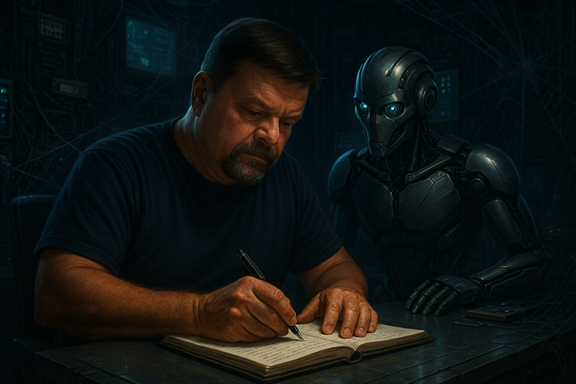

Title: Zero or One, not Fault Lines - Did We Remember the Humans?
Date: 2026-11-16
Category: Posts 
Tags: ai, journal
Slug: zero-or-one-not-fault-lines-.did-we-remember-the-humans
Author: Agent Ubuntu and Willy-Peter Schaub
Summary: The human loop is not disappearing. It is evolving.

There is an Agentic Software Development Life Cycle tsunami rolling towards our software engineering shores. Agents that plan. Agents that code. Agents that test. Agents that review. Agents that remediate. Agents talking to other agents.

>  


Very exciting, but before we all grab our surfboards and scream COWABUNGA, I have one uncomfortable question: **_Are we future-proofing our humans at the same speed that we are future-proofing our engineering ecosystem?_**

I do not believe Artificial Intelligence is killing the human loop. It is changing where the human sits in the loop.

The opportunity is to prepare people to move from doing the work → orchestrating the work, from writing every line → engineering intent and verifying outcomes, from manual toil → intelligent automation, and from operating yesterday's systems → shaping tomorrow's engineering ecosystem.

That means Artificial Intelligence fundamentals first. Generative Artificial Intelligence fluency next. Then Agentic Artificial Intelligence, safe delegation, verification, guardrails, and new human opportunities.

# 👤 What might the human journey look like?

The job titles of tomorrow may be different, but the experience our engineers have built remains enormously valuable. For example ...

## Software Developer

```
Code producer → Intent engineer → Agent orchestrator
```

Imagine spending less time producing every line of code and more time defining intent, engineering context, making architecture decisions, directing coding agents, reviewing generated changes, and verifying that the outcome is secure, maintainable and valuable.

## Quality Assurance Engineer

```
Test executor → Quality engineer → Artificial Intelligence verification & evaluation engineer
```

Imagine moving beyond repetitive manual test execution towards engineering quality strategies, generating tests with Artificial Intelligence, evaluating agent behaviour, designing adversarial scenarios, and producing the evidence that tells us whether human- and agent-generated software can be trusted.

## DevOps Engineer

```
Pipeline operator → Platform engineer → Agentic reliability & governance engineer
```

Imagine spending less time babysitting pipelines and environments and more time engineering paved roads, policy-as-code, observability, automated remediation, safe agent permissions and platforms where humans and agents can operate safely together.

Across all three, I see a similar journey. Do everything manually → Amplify yourself with AI → Delegate safely to agents → Verify outcomes → Engineer the ecosystem

## 🤖 The human loop is not dead. It is moving upstream.

Towards intent. Judgement. Creativity. Verification. Accountability. Governance. Leadership.

And perhaps that means we are asking the wrong question.

Instead of asking "**_Will Artificial Intelligence take my job?_**"
perhaps we should ask: "**_Which parts of my job should I gladly give Artificial Intelligence, and what will that free me to become?"_**

That is the future-proofing opportunity and responsibility in front of us as organisations and as individual humanoids.

We should not wait until these new opportunities have formal job descriptions before preparing people for them. We can start now with Artificial Intelligence fundamentals, Generative Artificial Intelligence, hands-on experimentation, working groups, learning by doing, and eventually our Agentic Software Development Life Cycle.

And we need to give people space to discover their future human persona, rather than assuming everybody follows the same path.

>
> Our responsibility is not to promise that today's jobs will remain unchanged.
>
> Our responsibility is to give our people a fair opportunity to evolve with the engineering ecosystem and become candidates for opportunities that may not even exist today.
>

Artificial Intelligence is not killing the human loop. It needs the human verification in the loop. And it could create a ton of new opportunities for humans who are curious, passionate, willing to learn, willing to let go of some of yesterday's work, and game enough to try something new.

So yes, let us future-proof the technology.

Let us future-proof our Engineering Foundations.

Let us embrace the Agentic Software Development Life Cycle.

But most importantly, **let us future-proof the humans.**

The wave is coming. 🌊

Who is game? 🤙

